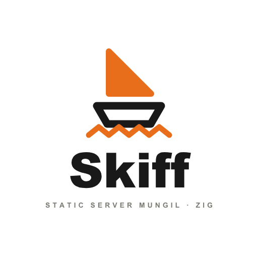

<div align="center">
  <picture>
    <source media="(prefers-color-scheme: dark)" srcset="assets/skiff-logo-dark.png">
    
  </picture>
  <h1>Skiff: Server File Statis Mungil</h1>
  <p><b>Sajikan folder mana pun sebagai situs statis lewat HTTP, dengan daftar direktori,<br/>
  streaming media dan tanpa dependensi. Berjalan offline.</b></p>

  <a href="https://github.com/nekonaru/skiff/releases"></a>
  <a href="https://github.com/nekonaru/skiff/actions/workflows/ci.yml"></a>
  
  
  
  
</div>

<br />

[English](README.md) | **Bahasa Indonesia**

> [!NOTE]
> Skiff adalah satu binary command line. Tanpa runtime, tanpa registry paket, tanpa akun. Masukkan ke flashdisk dan jalan di laptop mana pun.

---

## Table of Contents

- [Tentang](#tentang)
- [Fitur](#fitur)
- [Requirements](#requirements)
- [Instalasi](#instalasi)
- [Penggunaan](#penggunaan)
- [Konfigurasi](#konfigurasi)
- [Struktur Proyek](#struktur-proyek)
- [Development](#development)
- [Testing](#testing)
- [Keamanan](#keamanan)
- [Continuous Integration](#continuous-integration)
- [FAQ](#faq)
- [Author](#author)
- [Lisensi](#lisensi)

---

## Tentang

**Skiff** adalah alat command line mungil yang menyajikan folder sebagai situs statis lewat HTTP. Jalankan di direktori mana pun dan browser bisa membukanya di `http://127.0.0.1:8080`. Dibangun untuk demo cepat, hasil build frontend, dan berbagi file di jaringan yang sama, tanpa dependensi, satu binary di bawah 1 MB, dan dirancang untuk bekerja offline.

> _"Folder kamu, langsung jadi situs."_

---

## Fitur

### Penyajian

| Fitur | Deskripsi |
|-------|-----------|
| **File statis** | Sajikan HTML, CSS, JS, gambar, font, wasm dan lainnya, di-stream dari disk |
| **`index.html`** | Disajikan otomatis untuk direktori, termasuk subdirektori |
| **Daftar direktori** | Halaman HTML rapi saat tidak ada `index.html`, folder tampil lebih dulu |
| **MIME type** | 27 type bawaan, sisanya `application/octet-stream` |
| **Range request** | Seek video dan audio langsung jalan (`206`, `416`, suffix range) |
| **Keep-alive** | Koneksi persistent HTTP/1.1 dengan timeout koneksi idle |

### Cache dan Header

| Fitur | Deskripsi |
|-------|-----------|
| **ETag** | `ETag` lemah dari ukuran dan mtime file, cocok dengan `If-None-Match` untuk 304 |
| **Last-Modified** | `If-Modified-Since` didukung untuk revalidasi cache browser |
| **If-Range** | Request media yang bisa dilanjutkan hanya jika file tidak berubah |
| **nosniff** | `X-Content-Type-Options: nosniff` di semua response |
| **no-cache** | `Cache-Control: no-cache` di semua response file (revalidasi setiap saat) |

### Keamanan

| Fitur | Deskripsi |
|-------|-----------|
| **Path containment** | Persen-decode, normalisasi segmen, nama device Windows dan `..` ditolak, cek realpath containment |
| **Symlink aman** | Path kanonik setiap file yang disajikan harus tetap di dalam root yang disajikan |
| **Loopback secara default** | Bind ke `127.0.0.1` kecuali kamu memberi `--host` secara eksplisit |
| **Tidak mengeksekusi** | File hanya disajikan sebagai download atau dokumen |
| **HTML escaping** | Daftar direktori meng-escape nama dan URL |

### Tooling

| Fitur | Deskripsi |
|-------|-----------|
| **Satu binary** | Di bawah 1 MB per platform, tanpa runtime |
| **Offline** | Berjalan tanpa jaringan sama sekali |
| **`--spa`** | Fallback ke `index.html` untuk path yang tidak dikenal (single-page app) |
| **`--cors`** | Tambah `Access-Control-Allow-Origin: *` ke setiap response |
| **Access log** | Method, path, status, ukuran dan durasi untuk setiap request |

---

## Requirements

| Dependency | Versi Minimum | Catatan |
|------------|---------------|---------|
| **Zig** | 0.17.1 | Hanya diperlukan untuk build dari source |

> [!TIP]
> Kamu tidak butuh Zig jika mengunduh binary prebuilt. Lihat [Instalasi](#instalasi).

### Belum pernah pakai terminal? Mulai dari sini

<details>
<summary><b>Cara membuka terminal di Windows</b></summary>

1. Tekan tombol **Windows**, ketik `PowerShell`, lalu tekan **Enter**
2. Jendela biru terbuka. Itulah tempat mengetik perintah
3. Setiap perintah `skiff ...` di panduan ini diketik di jendela itu, diikuti **Enter**

</details>

---

## Instalasi

### Opsi A: Unduh binary (termudah)

1. Buka halaman [Releases](https://github.com/nekonaru/skiff/releases)
2. Unduh file untuk platformmu (`skiff-x86_64-windows.exe`, `skiff-x86_64-linux`, `skiff-aarch64-linux`, `skiff-x86_64-macos`, `skiff-aarch64-macos`)
3. Letakkan file di suatu tempat di `PATH`, misalnya `~/.local/bin/skiff` di Linux atau macOS, atau `C:\Tools\skiff.exe` di Windows
4. Jalankan `skiff --version` untuk memastikan berjalan

> [!IMPORTANT]
> Di Linux dan macOS, ubah file menjadi executable dulu: `chmod +x skiff-*`

### Opsi B: Build dari source (untuk development / membaca atau mengubah kode)

#### 1. Ambil kode proyek

<details>
<summary><b>Saya punya Git terinstal</b></summary>

```bash
git clone https://github.com/nekonaru/skiff.git
cd skiff
```

</details>

<details>
<summary><b>Saya belum punya Git</b></summary>

1. Buka halaman repository di GitHub
2. Klik tombol hijau **`Code`**, pilih **`Download ZIP`**
3. Ekstrak ZIP ke folder pilihan kamu
4. Di terminal, masuk ke folder hasil ekstrak, misalnya:

```bash
cd Downloads/skiff-main
```

</details>

#### 2. Instal Zig dan verifikasi

Unduh **Zig 0.17.1** dari [halaman download Zig](https://ziglang.org/download/) dan tambahkan ke `PATH` kamu.

> [!IMPORTANT]
> `zig version` harus mencetak `0.17.1`. Penggunaan `std.Io` di Skiff bergantung pada versi ini persis.

#### 3. Build

```bash
zig build -Doptimize=ReleaseSmall
```

Binary berada di `zig-out/bin/skiff` (atau `zig-out\bin\skiff.exe` di Windows).

---

## Penggunaan

### Pertama kali

1. Buka terminal di folder yang ingin disajikan
2. Jalankan `skiff`
3. Buka `http://127.0.0.1:8080` di browser

> [!NOTE]
> Skiff bind ke `127.0.0.1` secara default, jadi hanya mesin kamu sendiri yang bisa mengaksesnya. Gunakan `--host 0.0.0.0` untuk membukanya ke jaringan lokal.

### Penggunaan sehari-hari

- Sajikan folder saat ini: `skiff`
- Sajikan hasil build frontend: `skiff -d dist`
- Pilih port: `skiff -p 3000`
- Buka ke LAN: `skiff --host 0.0.0.0 -p 8080`
- Single-page app: `skiff --spa -d build`
- Hentikan server: tekan **Ctrl+C**

### Flag

| Flag | Singkat | Default | Deskripsi |
|------|---------|---------|-----------|
| `--port <port>` | `-p` | `8080` | Port untuk mendengarkan |
| `--dir <path>` | `-d` | `.` | Direktori root yang disajikan |
| `--host <addr>` | | `127.0.0.1` | Alamat bind, gunakan `0.0.0.0` untuk akses LAN |
| `--no-listing` | | off | Kembalikan 403 alih-alih daftar direktori |
| `--spa` | | off | Fallback ke `index.html` untuk path tidak dikenal |
| `--cors` | | off | Tambah `Access-Control-Allow-Origin: *` ke response |
| `--quiet` | | off | Sembunyikan access log |
| `--help` | `-h` | | Tampilkan bantuan dan keluar |
| `--version` | `-v` | | Tampilkan versi dan keluar |

---

## Konfigurasi

Skiff dikonfigurasi sepenuhnya lewat flag command line. Tidak ada file konfigurasi. Jalankan `skiff --help` untuk melihat tabel yang sama dari terminal kamu.

> [!NOTE]
> Skiff hanya menyajikan file. Ia tidak mengeksekusi script, tidak meresolusi target symlink `index.html` di luar root, dan tidak mengekspos direktori tersembunyi secara default. Permintaan direktori tanpa `index.html` menampilkan daftar nama dan ukuran biasa.

---

## Struktur Proyek

```
skiff/
├── build.zig               # definisi build (Zig 0.17.1)
├── build.zig.zon           # manifest paket, 0.17.1 terkunci
├── src/
│   ├── main.zig            # entry point, wiring argumen
│   ├── cli.zig             # parsing argumen + unit test
│   ├── server.zig          # accept loop, threads, penanganan HTTP
│   ├── fs_guard.zig        # resolusi path aman + unit test traversal
│   ├── mime.zig            # tabel MIME type
│   ├── range.zig           # parser header Range + unit test
│   ├── listing.zig         # HTML daftar direktori
│   ├── log.zig             # access logger
│   └── timefmt.zig         # format dan parsing tanggal HTTP
├── scripts/
│   └── release.sh          # cross-compile 5 target, gagal jika >= 1 MiB
├── assets/                 # file logo dan icon
├── docs/
│   └── decisions.md        # keputusan desain
├── .github/
│   └── workflows/
│       └── ci.yml          # test di 3 OS, cross-build, release pada tag
├── AGENTS.md               # metadata proyek untuk AI agent
├── LICENSE                 # MIT
├── README.md               # dokumentasi Inggris
└── README.id.md            # dokumentasi Bahasa Indonesia (file ini)
```

> [!NOTE]
> Layer HTTP/1.1 ditangani oleh `std.http.Server` dari standard library. Lihat `docs/decisions.md` untuk detailnya.

---

## Development

### Build dan jalankan

```bash
zig build
./zig-out/bin/skiff -d some/folder
```

### Cross-check semuanya

```bash
zig build test
scripts/release.sh
```

`scripts/release.sh` membangun semua lima target dan gagal jika ada binary 1 MiB atau lebih besar.

### Menambah MIME type

1. Buka `src/mime.zig`
2. Tambahkan extension dan type ke `table` (jaga urutan tetap terurut)
3. Tambahkan baris test di blok test yang sudah ada

---

## Testing

Verifikasi sebelum setiap push, keduanya harus bersih:

```bash
zig build test
scripts/release.sh
```

| Check | Requirement |
|-------|-------------|
| `zig build test` | Seluruh suite harus lolos (parser, traversal, Range, MIME, tanggal) |
| `scripts/release.sh` | Setiap binary rilis harus di bawah 1 MiB |

---

## Keamanan

- Penyajian dibatasi pada root yang disajikan; escape lewat symlink dan junction mengembalikan 403.
- Path input di-persen-decode, dinormalisasi, dan ditolak pada `..`, backslash dan nama device Windows.
- Skiff bind ke loopback secara default dan tidak mengeksekusi file.

> [!NOTE]
> Menemukan kerentanan? Laporkan secara privat lewat kontak di [`SECURITY.md`](SECURITY.md).

---

## Continuous Integration

| Workflow | Purpose |
|----------|---------|
| `ci.yml` | Test di Linux, Windows dan macOS; build ReleaseSafe; pastikan kelima target rilis ter-build dan tetap di bawah 1 MiB |
| `release` job | Pada tag `v*`, build binary rilis dan terbitkan GitHub Release dari `CHANGELOG.md` |

CI mengunci Zig ke 0.17.1 dengan verifikasi SHA-256 dan berjalan pada setiap push dan pull request.

---

## FAQ

<details>
<summary><b>Kenapa `skiff --host 0.0.0.0` tidak menampilkan alamat LAN?</b></summary>

Skiff mencetak `0.0.0.0:<port>` karena lookup LAN IP yang portabel tidak tersedia di build tanpa dependensi. Buka `http://<IP LAN mesin kamu>:<port>` dari perangkat lain.

</details>

<details>
<summary><b>Bisakah Skiff menyajikan PHP atau CGI?</b></summary>

Tidak. Skiff adalah static file server. Ia tidak mengeksekusi apa pun.

</details>

<details>
<summary><b>Kenapa daftar direktori tetap tampil padahal file bisa sensitif?</b></summary>

Hanya folder yang kamu berikan ke Skiff yang disajikan. Gunakan `--no-listing` untuk menonaktifkan daftar sepenuhnya (mengembalikan 403).

</details>

<details>
<summary><b>Bagaimana cara membuat `index.html` terbuka lewat HTTPS?</b></summary>

Letakkan Skiff di belakang reverse proxy seperti Caddy atau Nginx, atau gunakan setup `localhost` saja. Skiff sendiri menyajikan HTTP biasa.

</details>

---

## Author

<div align="center">

| [](https://github.com/nekonaru) |
|:---:|
| **Nicolas Dwi Dharma** |
| [github.com/nekonaru](https://github.com/nekonaru) |

</div>

---

## Lisensi

Didistribusikan di bawah **MIT License**. Lihat [`LICENSE`](LICENSE) untuk informasi lebih lanjut.
