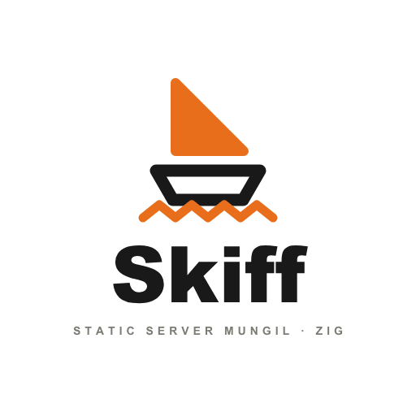

<div align="center">
  <picture>
    <source media="(prefers-color-scheme: dark)" srcset="assets/skiff-logo-dark.png">
    
  </picture>
  <h1>Skiff: Tiny Static File Server</h1>
  <p><b>Serve any folder as a static website over HTTP, with directory listing,<br/>
  media streaming and zero dependencies. Works offline.</b></p>

  <a href="https://github.com/nekonaru/skiff/releases"></a>
  <a href="https://github.com/nekonaru/skiff/actions/workflows/ci.yml"></a>
  
  
  
  
</div>

<br />

**English** | [Bahasa Indonesia](README.id.md)

> [!NOTE]
> Skiff is a single command line binary. No runtime, no package registry, no account. Put it on a flash drive and it works on any laptop.

---

## Table of Contents

- [About](#about)
- [Features](#features)
- [Requirements](#requirements)
- [Installation](#installation)
- [Usage](#usage)
- [Configuration](#configuration)
- [Project Structure](#project-structure)
- [Development](#development)
- [Testing](#testing)
- [Security](#security)
- [Continuous Integration](#continuous-integration)
- [FAQ](#faq)
- [Author](#author)
- [License](#license)

---

## About

**Skiff** is a tiny command line tool that serves a folder as a static website over HTTP. Run it in any directory and your browser can open it at `http://127.0.0.1:8080`. It is built for quick demos, frontend builds, and sharing files on the same network, with zero dependencies, a single binary under 1 MB, and an offline design.

> _"Your folder, instantly a website."_

---

## Features

### Serving

| Feature | Description |
|---------|-------------|
| **Static files** | Serve HTML, CSS, JS, images, fonts, wasm and more, streamed from disk |
| **`index.html`** | Served automatically for directories, including subdirectories |
| **Directory listing** | Clean HTML listing when there is no `index.html`, with folders first |
| **MIME types** | 27 built-in types, everything else falls back to `application/octet-stream` |
| **Range requests** | Video and audio seeking works out of the box (`206`, `416`, suffix ranges) |
| **Keep-alive** | HTTP/1.1 persistent connections with idle connection timeout |

### Caching and Headers

| Feature | Description |
|---------|-------------|
| **ETag** | Weak `ETag` from file size and mtime, matched by `If-None-Match` for 304 |
| **Last-Modified** | `If-Modified-Since` supported for browser cache revalidation |
| **If-Range** | Resumable media requests only if the file did not change |
| **nosniff** | `X-Content-Type-Options: nosniff` on all responses |
| **no-cache** | `Cache-Control: no-cache` on all file responses (revalidate every time) |

### Security

| Feature | Description |
|---------|-------------|
| **Path containment** | Percent-decoding, segment normalization, Windows device names and `..` rejected, realpath containment check |
| **Symlink safe** | Canonical path of every served file must stay inside the served root |
| **Loopback by default** | Binds to `127.0.0.1` unless you pass `--host` explicitly |
| **No execution** | Files are only ever served as downloads or documents |
| **HTML escaping** | Directory listings escape names and URLs |

### Tooling

| Feature | Description |
|---------|-------------|
| **Single binary** | Under 1 MB per platform, no runtime needed |
| **Offline** | Works with no network at all |
| **`--spa`** | Fall back to `index.html` for unknown paths (single-page apps) |
| **`--cors`** | Add `Access-Control-Allow-Origin: *` to every response |
| **Access log** | Method, path, status, size and duration for every request |

---

## Requirements

| Dependency | Minimum Version | Notes |
|------------|-----------------|-------|
| **Zig** | 0.17.1 | Only needed to build from source |

> [!TIP]
> You do not need Zig if you download the prebuilt binary. See [Installation](#installation).

### Never used a terminal? Start here

<details>
<summary><b>How to open a terminal on Windows</b></summary>

1. Press the **Windows** key, type `PowerShell`, then press **Enter**
2. A blue window opens. That is where you type commands
3. Every `skiff ...` command in this guide is typed in that window, followed by **Enter**

</details>

---

## Installation

### Option A: Download the binary (easiest)

1. Open the [Releases](https://github.com/nekonaru/skiff/releases) page
2. Download the file for your platform (`skiff-x86_64-windows.exe`, `skiff-x86_64-linux`, `skiff-aarch64-linux`, `skiff-x86_64-macos`, `skiff-aarch64-macos`)
3. Put the file somewhere on your `PATH`, for example `~/.local/bin/skiff` on Linux or macOS, or `C:\Tools\skiff.exe` on Windows
4. Run `skiff --version` to confirm it works

> [!IMPORTANT]
> On Linux and macOS, make the file executable first: `chmod +x skiff-*`

### Option B: Build from source (for development / to read or change the code)

#### 1. Get the project code

<details>
<summary><b>I have Git installed</b></summary>

```bash
git clone https://github.com/nekonaru/skiff.git
cd skiff
```

</details>

<details>
<summary><b>I don't have Git</b></summary>

1. Open the repository page on GitHub
2. Click the green **`Code`** button, choose **`Download ZIP`**
3. Extract the ZIP to a folder of your choice
4. In the terminal, go into the extracted folder, for example:

```bash
cd Downloads/skiff-main
```

</details>

#### 2. Install Zig and verify

Download **Zig 0.17.1** from the [Zig download page](https://ziglang.org/download/) and add it to your `PATH`.

> [!IMPORTANT]
> `zig version` must print `0.17.1`. Skiff's `std.Io` usage depends on this exact version.

#### 3. Build

```bash
zig build -Doptimize=ReleaseSmall
```

The binary is at `zig-out/bin/skiff` (or `zig-out\bin\skiff.exe` on Windows).

---

## Usage

### First launch

1. Open a terminal in the folder you want to serve
2. Run `skiff`
3. Open `http://127.0.0.1:8080` in your browser

> [!NOTE]
> Skiff binds to `127.0.0.1` by default, so only your own machine can reach it. Pass `--host 0.0.0.0` to open it to your local network.

### Everyday use

- Serve the current folder: `skiff`
- Serve a frontend build: `skiff -d dist`
- Pick a port: `skiff -p 3000`
- Open to the LAN: `skiff --host 0.0.0.0 -p 8080`
- Single-page app: `skiff --spa -d build`
- Stop the server: press **Ctrl+C**

### Flags

| Flag | Short | Default | Description |
|------|-------|---------|-------------|
| `--port <port>` | `-p` | `8080` | Port to listen on |
| `--dir <path>` | `-d` | `.` | Root directory to serve |
| `--host <addr>` | | `127.0.0.1` | Address to bind, use `0.0.0.0` for LAN access |
| `--no-listing` | | off | Return 403 instead of the directory listing |
| `--spa` | | off | Fall back to `index.html` for unknown paths |
| `--cors` | | off | Add `Access-Control-Allow-Origin: *` to responses |
| `--quiet` | | off | Suppress the access log |
| `--help` | `-h` | | Show help and exit |
| `--version` | `-v` | | Show the version and exit |

---

## Configuration

Skiff is configured entirely with command-line flags. There is no config file. Run `skiff --help` to see the same table from your terminal.

> [!NOTE]
> Skiff serves files only. It does not execute scripts, resolve `index.html` symlink targets outside the root, or expose hidden directories by default. Directory requests without `index.html` show a plain listing of names and sizes.

---

## Project Structure

```
skiff/
├── build.zig               # build definition (Zig 0.17.1)
├── build.zig.zon           # package manifest, 0.17.1 pinned
├── src/
│   ├── main.zig            # entry point, arg wiring
│   ├── cli.zig             # argument parsing + unit tests
│   ├── server.zig          # accept loop, threads, HTTP handling
│   ├── fs_guard.zig        # safe path resolution + traversal tests
│   ├── mime.zig            # MIME type table
│   ├── range.zig           # Range header parser + unit tests
│   ├── listing.zig         # directory listing HTML
│   ├── log.zig             # access logger
│   └── timefmt.zig         # HTTP date formatting and parsing
├── scripts/
│   └── release.sh          # cross-compile 5 targets, fail if >= 1 MiB
├── assets/                 # logo and icon files
├── docs/
│   └── decisions.md        # design decisions
├── .github/
│   └── workflows/
│       └── ci.yml          # test on 3 OSes, cross-build, release on tags
├── AGENTS.md               # project metadata for AI agents
├── LICENSE                 # MIT
├── README.md               # English documentation (this file)
└── README.id.md            # documentation (Bahasa Indonesia)
```

> [!NOTE]
> The HTTP/1.1 layer is handled by the standard library's `std.http.Server`. See `docs/decisions.md` for details.

---

## Development

### Build and run

```bash
zig build
./zig-out/bin/skiff -d some/folder
```

### Cross-check everything

```bash
zig build test
scripts/release.sh
```

`scripts/release.sh` builds all five targets and fails if any binary is 1 MiB or larger.

### Adding a MIME type

1. Open `src/mime.zig`
2. Add the extension and type to the `table` (keep the table sorted)
3. Add a test line in the existing test block

---

## Testing

Verification before every push, both must be clean:

```bash
zig build test
scripts/release.sh
```

| Check | Requirement |
|-------|-------------|
| `zig build test` | Must pass the full suite (parser, traversal, Range, MIME, dates) |
| `scripts/release.sh` | Every released binary must be under 1 MiB |

---

## Security

- Serving is contained to the served root; symlink and junction escapes return 403.
- Input paths are percent-decoded, normalized, and rejected on `..`, backslashes and Windows device names.
- Skiff binds to loopback by default and does not execute files.

> [!NOTE]
> Found a vulnerability? Report it privately via the contact listed in [`SECURITY.md`](SECURITY.md).

---

## Continuous Integration

| Workflow | Purpose |
|----------|---------|
| `ci.yml` | Test on Linux, Windows and macOS; build ReleaseSafe; assert all 5 release targets build and stay under 1 MiB |
| `release` job | On `v*` tags, build release binaries and publish a GitHub Release from `CHANGELOG.md` |

CI pins Zig to 0.17.1 with SHA-256 verification and runs on every push and pull request.

---

## FAQ

<details>
<summary><b>Why does `skiff --host 0.0.0.0` not show a LAN address?</b></summary>

Skiff prints `0.0.0.0:<port>` because a portable LAN IP lookup is not available in a dependency-free build. Open `http://<your LAN IP>:<port>` from the other device.

</details>

<details>
<summary><b>Can Skiff serve PHP or CGI?</b></summary>

No. Skiff is a static file server. It does not execute anything.

</details>

<details>
<summary><b>Why is directory listing shown even though files might be sensitive?</b></summary>

Only the folder you pass to Skiff is served. Use `--no-listing` to disable listings entirely (returns 403).

</details>

<details>
<summary><b>How do I make `index.html` load over HTTPS?</b></summary>

Put Skiff behind a reverse proxy such as Caddy or Nginx, or use a `localhost`-only setup. Skiff itself serves plain HTTP.

</details>

---

## Author

<div align="center">

| [](https://github.com/nekonaru) |
|:---:|
| **Nicolas Dwi Dharma** |
| [github.com/nekonaru](https://github.com/nekonaru) |

</div>

---

## License

Distributed under the **MIT License**. See [`LICENSE`](LICENSE) for more information.
